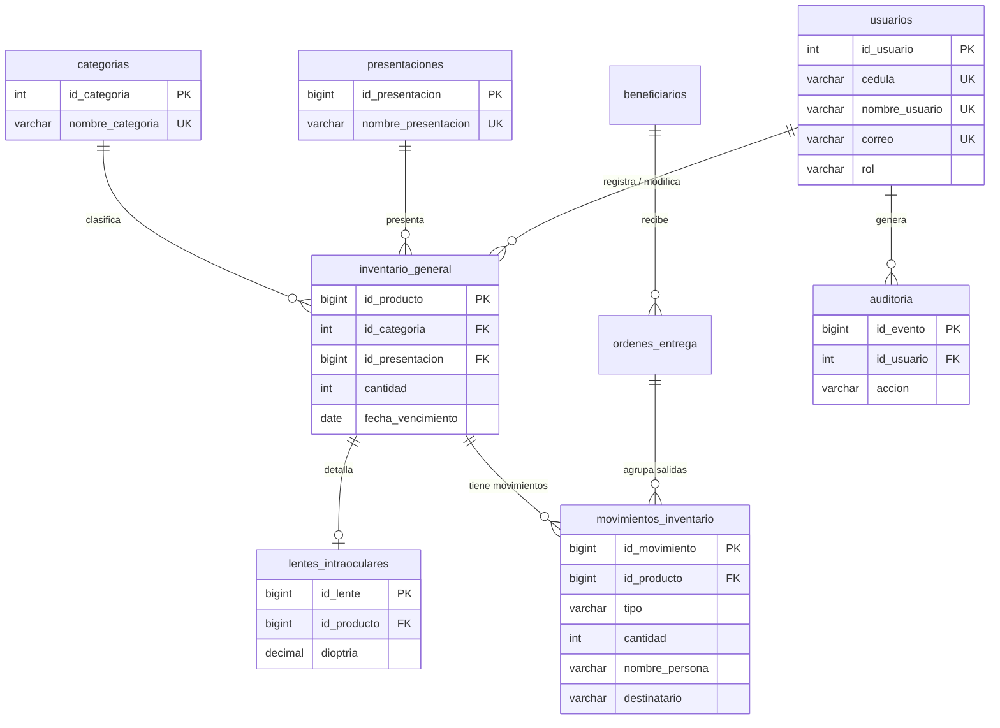

# Diccionario de datos – Sistema de Inventario Médico

Base de datos: `inventario_medico` (MySQL / MariaDB, utf8mb4).

**Campos de auditoría comunes** (están en *todas* las tablas):

| Campo | Tipo | Descripción |
|---|---|---|
| status | ENUM('Activo','Inactivo') | Estatus del registro. La "baja" cambia este campo; no se borran filas. |
| fecha_registro | DATETIME | Fecha y hora de creación (automática). |
| fecha_modificacion | DATETIME NULL | Fecha y hora de la última modificación (automática). |
| usuario_registro | INT UNSIGNED NULL, FK → usuarios | Usuario que creó el registro. |
| usuario_modificacion | INT UNSIGNED NULL, FK → usuarios | Último usuario que lo modificó. |

## usuarios
Personas que ingresan al sistema.

| Campo | Tipo | Restricciones | Descripción |
|---|---|---|---|
| id_usuario | INT UNSIGNED | PK, AUTO_INCREMENT | Identificador. |
| cedula | VARCHAR(10) | UNIQUE, NOT NULL | Cédula (solo dígitos, 6 a 10). |
| nombre_usuario | VARCHAR(30) | UNIQUE, NOT NULL | Nombre de acceso. |
| nombre_completo | VARCHAR(100) | NOT NULL | Nombres y apellidos. |
| correo | VARCHAR(100) | UNIQUE, NOT NULL | Correo electrónico. |
| clave | VARCHAR(255) | NOT NULL | Contraseña cifrada con `password_hash()` (bcrypt). |
| rol | ENUM('Administrador','Encargado') | NOT NULL | Define los permisos. |

## categorias
| Campo | Tipo | Restricciones | Descripción |
|---|---|---|---|
| id_categoria | INT | PK, AUTO_INCREMENT | Identificador. |
| nombre_categoria | VARCHAR(50) | UNIQUE, NOT NULL | Medicamentos, Médico Quirúrgico, Blíster, Oftalmología, Ayudas Técnicas. |

## presentaciones
| Campo | Tipo | Restricciones | Descripción |
|---|---|---|---|
| id_presentacion | BIGINT UNSIGNED | PK, AUTO_INCREMENT | Identificador. |
| nombre_presentacion | VARCHAR(50) | UNIQUE, NOT NULL | Ampollas, Gotas, Unidades, etc. |

## inventario_general
| Campo | Tipo | Restricciones | Descripción |
|---|---|---|---|
| id_producto | BIGINT UNSIGNED | PK, AUTO_INCREMENT | Identificador. |
| nombre_producto | VARCHAR(150) | NOT NULL | Nombre del insumo. |
| id_categoria | INT | FK → categorias | Categoría del insumo. |
| id_presentacion | BIGINT UNSIGNED | FK → presentaciones | Presentación del insumo. |
| cantidad | INT | NOT NULL, CHECK ≥ 0 | Existencias. |
| fecha_vencimiento | DATE NULL | — | Vencimiento (vacío si no vence). |

Restricción UNIQUE `uq_producto_lote` (nombre_producto, id_categoria, id_presentacion, fecha_vencimiento): evita duplicados a nivel de motor.

## lentes_intraoculares
| Campo | Tipo | Restricciones | Descripción |
|---|---|---|---|
| id_lente | BIGINT UNSIGNED | PK, AUTO_INCREMENT | Identificador. |
| id_producto | BIGINT UNSIGNED | FK → inventario_general, UNIQUE | Producto al que corresponde el lente. |
| dioptria | DECIMAL(4,2) | NOT NULL | Dioptría del lente. |

## beneficiarios
Registro numerado de las personas a quienes se entrega medicamento.

| Campo | Tipo | Restricciones | Descripción |
|---|---|---|---|
| id_beneficiario | INT UNSIGNED | PK, AUTO_INCREMENT | Número correlativo del beneficiario (se muestra como 0001, 0002...). |
| nombres | VARCHAR(60) | NOT NULL | Nombres. |
| apellidos | VARCHAR(60) | NOT NULL | Apellidos. |
| tipo_documento | ENUM('V','E','RIF','P') | NOT NULL, por defecto V | Tipo de documento: V cédula venezolana, E cédula de extranjero, RIF o P pasaporte. |
| cedula | VARCHAR(20) | NOT NULL | Número del documento, sin guiones (en RIF incluye la letra). Con `tipo_documento` forma una clave UNIQUE. |
| telefono | VARCHAR(20) NULL | — | Teléfono (opcional). |
| tipo_beneficiario | ENUM('Trabajador','Afiliado') | NOT NULL | Condición del beneficiario. |

## ordenes_entrega
Cada orden agrupa los medicamentos entregados a un beneficiario en una fecha.

| Campo | Tipo | Restricciones | Descripción |
|---|---|---|---|
| id_orden | BIGINT UNSIGNED | PK, AUTO_INCREMENT | Número correlativo de la orden (se muestra como OE-000001). |
| id_beneficiario | INT UNSIGNED | FK → beneficiarios | Quién recibe. |
| fecha_salida | DATE | NOT NULL | Fecha de la entrega. |
| observacion | VARCHAR(255) NULL | — | Nota opcional. |
| recipe_archivo | VARCHAR(100) NULL | — | Nombre con que se guardó el récipe en `uploads/recipes` (aleatorio). |
| recipe_original | VARCHAR(150) NULL | — | Nombre original del archivo subido. |
| recipe_numero | VARCHAR(30) NULL | — | Número del récipe de la persona. |

Cada medicamento de la orden es una fila de `movimientos_inventario` (tipo Salida) con `id_orden` apuntando a la orden.

## movimientos_inventario
Control de entradas y salidas de insumos. Cada movimiento es un registro permanente (no se edita ni se borra).

| Campo | Tipo | Restricciones | Descripción |
|---|---|---|---|
| id_movimiento | BIGINT UNSIGNED | PK, AUTO_INCREMENT | Identificador. |
| id_producto | BIGINT UNSIGNED | FK → inventario_general | Insumo que entra o sale. |
| id_orden | BIGINT UNSIGNED NULL | FK → ordenes_entrega | Orden de entrega a la que pertenece (solo salidas). |
| tipo | ENUM('Entrada','Salida') | NOT NULL | Tipo de movimiento. |
| cantidad | INT | NOT NULL, CHECK > 0 | Unidades que entran o salen. |
| existencia_resultante | INT | NOT NULL | Existencia del insumo después del movimiento. |
| fecha_movimiento | DATE | NOT NULL | Fecha en que ocurrió. |
| nombre_persona | VARCHAR(100) | NOT NULL | Salida: quien retira. Entrada: quien entrega o proveedor. |
| cedula_persona | VARCHAR(20) | NOT NULL | Documento de esa persona (cédula, RIF, extranjero o pasaporte). |
| destinatario | VARCHAR(100) NULL | — | Salida: paciente o servicio para quien es el insumo. |
| observacion | VARCHAR(255) NULL | — | Nota opcional. |

## auditoria
Historial de eventos que consulta el administrador.

| Campo | Tipo | Restricciones | Descripción |
|---|---|---|---|
| id_evento | BIGINT UNSIGNED | PK, AUTO_INCREMENT | Identificador. |
| id_usuario | INT UNSIGNED NULL | FK → usuarios | Usuario que realizó la acción (nulo si no se identificó). |
| nombre_usuario | VARCHAR(50) | NOT NULL | Nombre de usuario en el momento del evento. |
| accion | VARCHAR(30) | NOT NULL | LOGIN, LOGIN_FALLIDO, LOGOUT, CREAR_PRODUCTO, EDITAR_PRODUCTO, BAJA_PRODUCTO, REACTIVAR_PRODUCTO, CREAR_USUARIO, EDITAR_USUARIO, REPORTE, ENTRADA_INSUMO, SALIDA_INSUMO, ORDEN_ENTREGA, CREAR_BENEFICIARIO, EDITAR_BENEFICIARIO, SESION_EXPIRADA, EXPORTAR_PDF. |
| tabla_afectada | VARCHAR(50) NULL | — | Tabla sobre la que se actuó. |
| id_registro | BIGINT UNSIGNED NULL | — | Id del registro afectado. |
| detalle | VARCHAR(500) NULL | — | Descripción del cambio. |
| ip_origen | VARCHAR(45) NULL | — | Dirección IP. |

## Vista v_inventario
Une inventario_general + categorias + presentaciones y calcula `estado_vencimiento`: **Vencido** (fecha pasada), **Por Vencer** (vence en 90 días o menos) o **Disponible**.

## Modelo Entidad-Relación (MER)

(Además, `usuario_registro` y `usuario_modificacion` de todas las tablas son FK hacia `usuarios`.)
